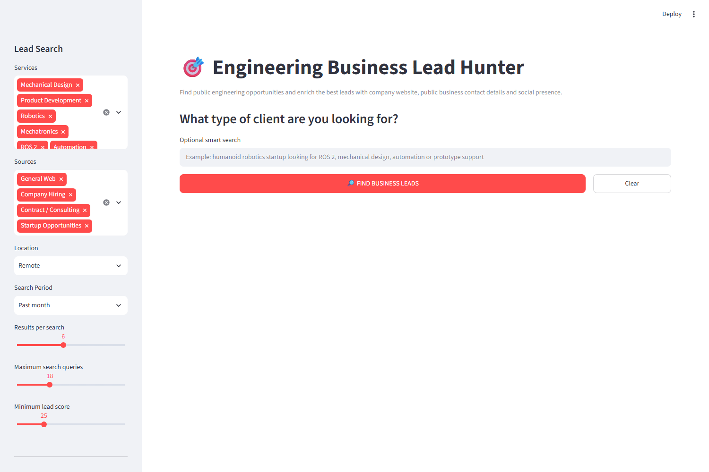

# Engineering Lead Hunter

A Streamlit app that turns the engineering services you offer (mechanical design, CAD, robotics, ROS 2, PLC, FEA and more) into targeted web searches, scores each result for hiring, contract and project intent, and enriches the best leads with each company's public website, contact page and social profiles.

[](https://www.python.org/downloads/)
[](https://streamlit.io/)
[](LICENSE)



## Why I built this

Contract work in mechanical design, CAD, robotics and controls is rarely posted in one place. It is spread across company career pages, applicant-tracking systems such as Lever, Greenhouse and Ashby, startup directories and tender notices, and most search results for these terms are courses, tutorials or salary guides. This app automates the first pass: it runs the searches, ranks results by how strongly they signal a real need for engineering help, and gathers the public company details you need to decide whether a lead is worth a tailored message.

## Features

- **20 engineering service categories**, each with its own keyword list: Mechanical Design, CAD / SolidWorks / Fusion 360, Product Development, Robotics, Humanoid Robotics, Robotic Arms / Grippers, Mechatronics, ROS 2, Automation, PLC / HMI / Controls, Drones / UAV, Drone Payload Integration, CNC Design, Jigs / Fixtures / Tooling, 3D Printing / Prototyping, Embedded Systems, Motor / Actuator Control, Computer Vision, Simulation / FEA and Robot Simulation.
- **12 source channels** with their own query templates: General Web, Company Hiring, Contract / Consulting, Startup Opportunities, Product Development Projects, Freelance Projects, Lever Jobs, Greenhouse Jobs, Ashby Jobs, Y Combinator, Wellfound and RFP / RFQ / Tender. Job-board channels use `site:` searches (`jobs.lever.co`, `greenhouse.io`, `jobs.ashbyhq.com`, `ycombinator.com`, `wellfound.com`), so the boards are reached through search results and are never scraped directly.
- **16 locations** (Worldwide, Remote, USA, Canada, United Kingdom, Germany, France, Netherlands, Europe, UAE, Saudi Arabia, Qatar, Australia, Singapore, Pakistan, India) and a search period filter (past week, month or year, or any time).
- **Optional free-text "smart search"** that runs before the generated queries, with the selected location appended (unless it is Worldwide).
- **Keyless web search** through the `ddgs` metasearch library. Duplicate queries are removed, the list is capped by a query budget, and a progress bar and status line show each query as it runs. Results are cached for 20 minutes, and a failed date-filtered search is retried once without the date filter.
- **Transparent lead scoring (0-100)** from keyword rules, with quality labels (Strong, Good, Possible, Low Relevance) and a rule-based lead type (RFP / RFQ, Contract / Consulting, Outsourcing / Partner, Hiring, Product Development, Potential Opportunity). See [How the scores are calculated](#how-the-scores-are-calculated).
- **Company name inference** from Lever, Greenhouse, Ashby and Y Combinator URL slugs, then from "at Company" / "@ Company" in the title, then from the result's own domain (when it is not a job board or social site), then from title separators.
- **Deduplication** by canonical URL and by opportunity title.
- **Optional company enrichment** for the top N leads:
  - finds the official website (the result's own domain, or a `"<company>" official website` search when the result came from a job board or social site);
  - fetches the homepage (8 s timeout, follows redirects, HTML responses only, first 2 million characters kept, cached for 1 hour);
  - pulls a company summary from the `description`, `og:description` or `twitter:description` meta tag;
  - picks a business email: addresses on the company's own domain come first, role prefixes such as `info@`, `sales@`, `careers@` and `partnerships@` are preferred, and placeholder or third-party service domains such as `example.com`, `sentry.io` and `wixpress.com` are filtered out;
  - reads a public phone number from `tel:` links;
  - detects LinkedIn company, X / Twitter, Instagram, Facebook, YouTube and GitHub links plus the contact and careers pages;
  - checks the contact page as well when the homepage has no email;
  - computes a weighted **Social Presence** score (0-100).
- **Results dashboard**: a run summary, five metrics (useful leads, strong leads, websites, business emails, LinkedIn pages), a sortable lead table with progress bars and clickable links, the top 10 leads as expandable cards with link buttons, and a one-click CSV download.
- **Nothing is written to disk.** Results live in Streamlit session state until you press **Clear** or close the tab, and the CSV for the download button is built in memory.

## Tech stack

| Layer | Tools |
| --- | --- |
| Language | Python 3.11+ |
| UI, caching, session state | [Streamlit](https://streamlit.io/) |
| Lead table, deduplication, CSV export | [pandas](https://pandas.pydata.org/) |
| Web search | [ddgs](https://pypi.org/project/ddgs/) (unofficial metasearch library, no API key) |
| HTTP fetching | [requests](https://requests.readthedocs.io/) |
| HTML parsing | [Beautiful Soup 4](https://www.crummy.com/software/BeautifulSoup/) with Python's built-in `html.parser` |
| Text and URL handling | Standard library `re` and `urllib.parse` |

## Getting started

### Prerequisites

- Python 3.11 or newer (pandas 3 requires it)
- Git
- An internet connection. No API keys or accounts are needed.

### Installation

```bash
git clone https://github.com/uzairsynth/engineering-lead-hunter.git
cd engineering-lead-hunter
python -m venv .venv
```

Activate the virtual environment:

```powershell
# Windows (PowerShell)
.venv\Scripts\Activate.ps1
```

```bat
:: Windows (Command Prompt)
.venv\Scripts\activate.bat
```

```bash
# macOS / Linux
source .venv/bin/activate
```

Install the dependencies and start the app:

```bash
pip install -r requirements.txt
streamlit run app.py
```

Streamlit opens the app in your browser, by default at <http://localhost:8501>.

## Usage walkthrough

1. **Choose your services.** In the sidebar, pick the work you offer from the **Services** list. Eight are selected by default (Mechanical Design, Product Development, Robotics, Mechatronics, ROS 2, Automation, Drones / UAV, CNC Design).
2. **Choose your sources.** Pick channels under **Sources**. The defaults are General Web, Company Hiring, Contract / Consulting and Startup Opportunities. Add Lever, Greenhouse, Ashby, Y Combinator or Wellfound to search applicant-tracking systems and startup boards, or RFP / RFQ / Tender for formal bids.
3. **Set location and recency.** Pick a **Location** (default: Remote) and a **Search Period** (default: Past month).
4. **Tune the search.**
   - **Results per search** (3-10, default 6): results requested per query.
   - **Maximum search queries** (4-50, default 18): the query budget.
   - **Minimum lead score** (0-100, default 25): results below this score are dropped.
5. **Decide on enrichment.** **Find website, email, phone and socials** is on by default, and **Enrich top leads** (1-20, default 5) sets how many of the highest-scoring leads get company research.
6. **Optionally describe your ideal client** in **Optional smart search**, for example *humanoid robotics startup looking for ROS 2, mechanical design, automation or prototype support*. This query runs first.
7. **Click FIND BUSINESS LEADS.** A progress bar shows each search, then each company being researched.
8. **Review the results.**
   - The summary line shows raw results, useful leads and how many searches failed or were rate-limited.
   - **Lead Database** lists every lead. Click a column header to sort, and use the link columns to open the opportunity, website or social profiles.
   - **Top Opportunities** shows the ten best leads as cards with quality, lead type, matched services, company summary, public contact details and link buttons.
   - **Download Complete Lead Database** exports every column, including the company summary, contact and careers pages, source domain and search query, to `engineering_business_leads.csv`.
9. Click **Clear** to reset the results.

> **Tip: how the query budget is spent.** Queries are generated source by source, so the number of candidate queries is *services x sources*, plus one if you use the smart search (which also takes one slot of the budget). With the defaults that is 8 x 4 = 32 candidates against a budget of 18, so the first two sources run for every service, the third runs for two services, and **Startup Opportunities never runs**. To cover every source, raise **Maximum search queries** or select fewer services.

### How the scores are calculated

Each search result's title, snippet and URL are lower-cased and checked against keyword lists defined at the top of `app.py`.

| Signal | Points |
| --- | --- |
| A keyword from at least one selected service appears | +30 |
| Each additional matched service | +5 (max +15) |
| Each high-intent phrase (*hiring, looking for, seeking, contractor, freelance, consultant, outsourcing, partner, vendor, prototype, RFP, RFQ, tender, vacancy, apply*, ...) | +7 (max +25) |
| Any contract term (*contract, freelance, consultant, consulting, outsourcing*, ...) | +10 |
| Any startup term (*startup, venture, seed, series a, series b, founder, early stage*, ...) | +8 |
| Any product term (*prototype, product development, hardware, robot, device, machine, manufacturing*) | +7 |
| The result is on a job board or marketplace (Lever, Greenhouse, Ashby, Wellfound, LinkedIn, Indeed, Upwork, ...) | +5 |
| Each negative term (*course, training course, tutorial, certification, salary guide, resume example, interview questions, definition, what is, wikipedia*) | -10 |

The total is clamped to 0-100 and labelled **Strong Lead** (75+), **Good Lead** (55+), **Possible Lead** (35+) or **Low Relevance**.

**Lead type** is the first rule that matches the title and snippet: RFP / RFQ, then Contract / Consulting, Outsourcing / Partner, Hiring and Product Development, otherwise Potential Opportunity.

**Social Presence** adds a fixed weight for each field enrichment found. It is only calculated when the company homepage was fetched successfully, and stays at 0 otherwise.

| Field | Weight |
| --- | --- |
| Business email | 20 |
| LinkedIn company page | 20 |
| Official website | 15 |
| Public phone | 10 |
| Contact page | 10 |
| GitHub | 7 |
| X / Twitter | 5 |
| Instagram | 5 |
| YouTube | 5 |
| Facebook | 3 |

### Customizing

The service taxonomy and scoring vocabulary are plain Python constants near the top of `app.py`, so you can change them for your own niche: `SERVICES`, `CHANNELS`, `LOCATIONS`, `HIGH_INTENT`, `CONTRACT_TERMS`, `STARTUP_TERMS`, `PRODUCT_TERMS`, `NEGATIVE_TERMS`, `AGGREGATORS` and `GENERIC_EMAIL_PREFIXES`. Query wording for each channel lives in `build_query`.

## Project structure

```text
engineering-lead-hunter/
├── app.py              # The whole app: search, scoring, enrichment and Streamlit UI
├── docs/
│   └── screenshot.png  # README screenshot
├── requirements.txt    # Third-party dependencies
├── .gitignore          # Also keeps exported lead CSVs out of Git
├── LICENSE             # MIT
└── README.md
```

## Known limitations

These are known issues in the current version. Each one has a matching item in the roadmap.

- Keyword and domain checks use plain substring matching. For example, `fea` matches "feature", `hmi` matches "Schmidt", and `x.com` matches `spacex.com` or `dropbox.com`. Those companies' own sites are treated as social or job-board sites, so they are never used as a company name or official website, and any link containing `x.com/` (such as a Dropbox link) can be stored as a company's X / Twitter profile.
- Official-website discovery takes the first search result that is not on the job-board or social list, so a directory or news site (for example Crunchbase or Wikipedia) can be recorded and enriched as the company's website.
- The email regex runs over raw HTML, so an image name such as `logo@2x.png` can occasionally be picked as an email. The same-domain check uses a suffix match, so a lookalike domain can pass, and phone numbers are taken from `tel:` links as written, without validation.
- URLs are canonicalized by dropping the whole query string, which can merge distinct job postings (for example Greenhouse `?gh_jid=` links). Leads are also deduplicated by title alone, so two companies posting the same job title collapse into one lead.
- Search queries use only the first keyword of each service. The other keywords are used for scoring only.
- The search region is always `us-en`, whatever location you select.
- A failed or rate-limited search is cached for 20 minutes, and enrichment errors are skipped silently.
- Searches and enrichment run one at a time, so large query budgets are slow.

## Roadmap

**Code quality**

- [ ] Remove leftover development comments and run `ruff format` / `ruff check --fix` to collapse the very vertical formatting
- [ ] Split `app.py` into a package (`config`, `search`, `scoring`, `company`, `enrich`, `models`) with a thin Streamlit UI on top
- [ ] Add type hints and docstrings, and move the service taxonomy, term lists and weights into a config file (TOML or YAML)
- [ ] Replace the deprecated `use_container_width=True` with `width="stretch"`

**Correctness**

- [ ] Compare parsed hostnames (`host == d or host.endswith("." + d)`) instead of substrings in aggregator, social-link and same-domain email checks
- [ ] Skip directory and news sites (Crunchbase, Wikipedia and similar) when discovering a company's official website
- [ ] Reject asset file names (`.png`, `.jpg`, `.webp`, `.svg`, `.gif`) in email extraction and drop the fallback to named-person addresses
- [ ] Normalize and validate phone numbers before showing them
- [ ] Use word-boundary regexes for keyword matching
- [ ] Use more than the first keyword of each service when building search queries
- [ ] Interleave queries round-robin across sources so every selected source runs within the budget
- [ ] Stop caching failed searches
- [ ] Keep job-identifying query parameters such as `gh_jid`, and deduplicate on company plus title

**Testing and CI**

- [ ] pytest suite for the pure functions (normalization, URL canonicalization, query building, scoring, lead type, company-name inference, email selection, Social Presence), with a regression test for each known bug
- [ ] Offline enrichment tests against saved HTML fixtures with HTTP mocked
- [ ] GitHub Actions running ruff, mypy and pytest on Python 3.11-3.13, with a status badge

**Responsible scraping and reliability**

- [ ] Honest User-Agent that identifies the project, plus `robots.txt` checks with `urllib.robotparser`
- [ ] Per-domain rate limiting with exponential backoff on search rate limits
- [ ] Role-based business emails only, and a data-protection / anti-spam notice in the UI
- [ ] Logging instead of silent exception handling, with a skipped / failed count in the UI
- [ ] Bounded `ThreadPoolExecutor` for enrichment and, within search rate limits, for searches
- [ ] Map the selected location to a matching search region

**Features**

- [ ] Live demo on Streamlit Community Cloud with a demo mode that loads cached sample results
- [ ] SQLite persistence so leads are deduplicated across runs and carry a status (new / contacted / ignored)
- [ ] Command-line entry point for scheduled runs that export to CSV
- [ ] Optional LLM re-ranker for lead relevance, off by default and using your own API key
- [ ] Write-up of the scoring design with a small hand-labelled evaluation set measuring precision before and after the fixes

## Responsible use

This tool is meant for finding **public business opportunities** and the **public business contact points** of the companies behind them. It is not meant for building mailing lists of individuals. Please read this before you use it.

- **Search engine terms.** `ddgs` is an unofficial library that queries public search engines without an official API. Automated querying may break those providers' terms of service and can get your IP address rate-limited or blocked. The app does not throttle its requests, so keep the query budget modest and don't run it in a tight loop.
- **Website fetching.** Enrichment downloads a company's homepage and sometimes its contact page. The current version sends a browser-style User-Agent and does not check `robots.txt` (both are on the roadmap). Enrich only a handful of leads and respect each site's terms.
- **Personal data.** The app prefers role-based addresses such as `info@` or `sales@`, but if none is found it falls back to another address found on the page (the alphabetically first one), which may belong to a named person. Treat any address or phone number that identifies a person as personal data. Data-protection and anti-spam laws may apply to how you store it and contact people, including GDPR and the ePrivacy rules in the EU, UK GDPR and PECR in the UK, CASL in Canada and CAN-SPAM in the US. You are responsible for having a lawful basis, identifying yourself, honouring opt-outs and not sending bulk unsolicited email.
- **Exported CSVs.** The download contains scraped emails and phone numbers. Don't commit it (`.gitignore` already excludes `*.csv`), don't share it publicly, and delete it when you no longer need it.
- **Job boards.** Lever, Greenhouse, Ashby, Y Combinator and Wellfound are only reached through search-engine snippets. Don't extend the app to scrape those sites or LinkedIn directly, because that breaks their terms of service.
- **Third-party text.** Company summaries are copied from websites' meta descriptions and belong to their owners.

This project is provided as-is under the MIT License and is not legal advice.

## License

Released under the [MIT License](LICENSE). Copyright (c) 2026 Muhammad Uzair.

## Author

Built by **Muhammad Uzair** ([@uzairsynth](https://github.com/uzairsynth)).
